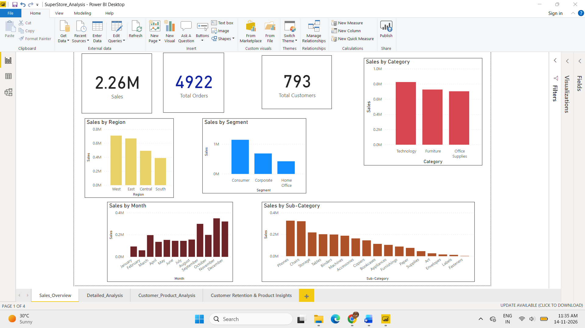
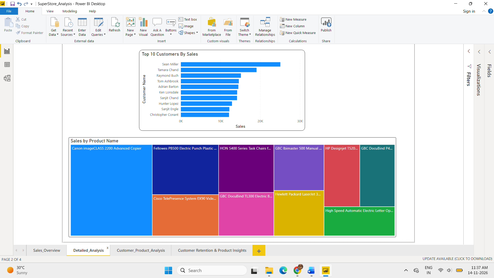

# Retail Sales Analysis | SQL, Power BI & Python

## Project Overview

This project analyses retail sales data to identify business trends, evaluate product and regional performance, understand customer purchasing behaviour, and generate actionable business insights.

The project uses MySQL for SQL-based business analysis, Python for data analysis and forecasting, and Microsoft Power BI for interactive dashboards.

## Dataset Information

- **Dataset:** Sales Forecasting – Superstore
- **Source:** [Kaggle – Sales Forecasting Dataset](https://www.kaggle.com/datasets/rohitsahoo/sales-forecasting)
- **CSV File:** `superstore.csv`
- **Records:** 9,800
- **Columns:** 18
- **Period:** 2015–2018

## Tools & Technologies

- **MySQL:** Data exploration, data quality checks and business analysis
- **Python:** Pandas, NumPy, Matplotlib and Scikit-learn
- **Microsoft Power BI:** Interactive dashboards and visualisation
- **DAX:** Measures and customer classification
- **Microsoft Excel:** Initial dataset inspection

## Project Workflow

1. Dataset inspection and preparation.
2. Database and table creation in MySQL.
3. CSV data import and verification.
4. SQL-based business analysis.
5. Python data quality checks and analysis.
6. RFM customer segmentation.
7. Basic sales forecasting using Linear Regression.
8. Power BI dashboard development.
9. Business insights and recommendations.

## Key Performance Indicators

| Metric | Result |
|---|---:|
| Total Sales | $2,261,536.78 |
| Total Records | 9,800 |
| Unique Orders | 4,922 |
| Unique Customers | 793 |
| Repeat Customers | 780 |
| One-time Customers | 13 |

## SQL Analysis – MySQL

Performed business analysis using SQL queries, including:

- Data exploration and quality checks
- Sales by category and sub-category
- Regional and segment-wise sales
- Top customers and products
- Monthly and yearly sales trends
- State and city performance
- Shipping mode analysis
- Customer purchase frequency and retention

**SQL File:** [View SQL Queries](queries.sql)

## Python Analysis

Used Python libraries to perform additional analysis and validate SQL results.

**Libraries:** Pandas, NumPy, Matplotlib and Scikit-learn.

### 1. Data Quality Checks
- Checked missing values and duplicate records.
- Identified 11 missing Postal Code values.
- Found zero duplicate rows.
- Validated total sales, orders and customers against SQL results.

### 2. Monthly and Yearly Sales Analysis
- Analysed monthly sales trends.
- Compared yearly sales from 2015 to 2018.
- Created visualisations using Matplotlib.

### 3. RFM Customer Segmentation

Performed Recency, Frequency and Monetary analysis for 793 customers.

| Customer Segment | Customers |
|---|---:|
| High Value | 201 |
| Regular | 298 |
| At Risk | 178 |
| Low Value | 116 |

Used custom RFM scoring rules to classify customers.

### 4. Basic Sales Forecasting

Applied Linear Regression to historical yearly sales data.

| Year | Forecasted Sales |
|---|---:|
| 2019 | $782,220.19 |
| 2020 | $868,954.59 |

**Note:** The forecast is illustrative and based on only four annual observations. It should not be treated as a reliable business prediction.

**Python Notebook:** [Retail Sales Analysis Python](Retail_Sales_Analysis_Python.ipynb)

## Power BI Dashboards

Created four interactive dashboard pages:

1. Sales Overview
2. Detailed Analysis
3. Customer and Geographic Analysis
4. Customer Retention and Product Insights

### Dashboard Screenshots

**Power BI File:** `SuperStore_Analysis.pbix`

## Key Business Insights

1. Technology generated $827,455.87, contributing 36.6% of total sales.
2. The West region generated $710,219.68, contributing 31.4%.
3. Consumer customers contributed $1,148,060.53, approximately 50.8% of sales.
4. Phones was the highest-selling sub-category at $327,782.45.
5. California was the leading state, with $446,306.46 in sales.
6. New York City generated $252,462.55 in sales.
7. November 2018 recorded the highest monthly sales at $117,938.16.
8. Annual sales increased by 30.6% in 2017 and 20.3% in 2018.

## Business Recommendations

- Maintain sufficient inventory for high-performing categories and products.
- Investigate regional sales differences.
- Develop customer retention and loyalty strategies.
- Engage at-risk customers through targeted campaigns.
- Use historical sales trends to support inventory and sales planning.

## Data Limitations

- The dataset does not contain Quantity, Profit or Discount columns.
- Sales figures should not be interpreted as profit.
- Product record frequency does not represent actual units sold.
- The forecasting model uses only four annual observations and has limited predictive reliability.

## Project Files

- `queries.sql` – SQL business analysis
- `Retail_Sales_Analysis_Python.ipynb` – Python analysis
- `SuperStore_Analysis.pbix` – Power BI dashboard
- `screenshots/` – Dashboard screenshots
- `Retail_Sales_Analysis_Final_Report.pdf` – Final project report

## Project Outcome

Developed an end-to-end retail sales analysis project using MySQL, Python and Power BI, covering 9,800 records and generating business insights through SQL analysis, customer segmentation, visualisation and basic forecasting.
