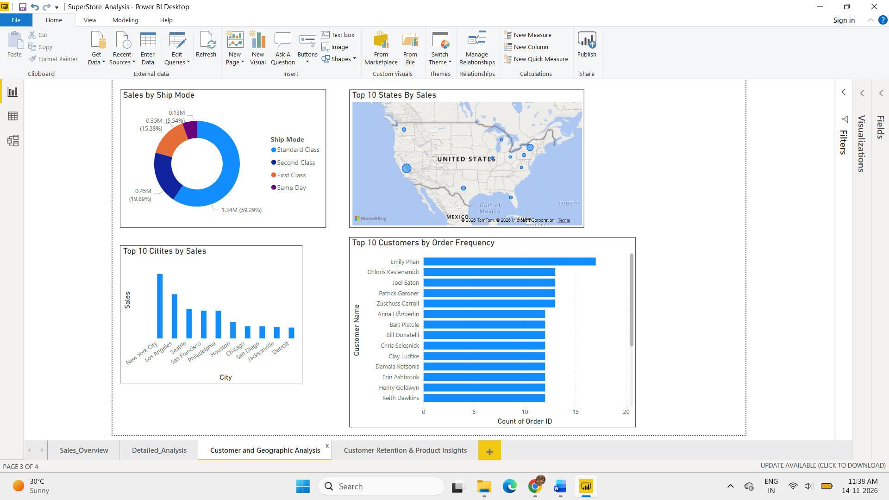
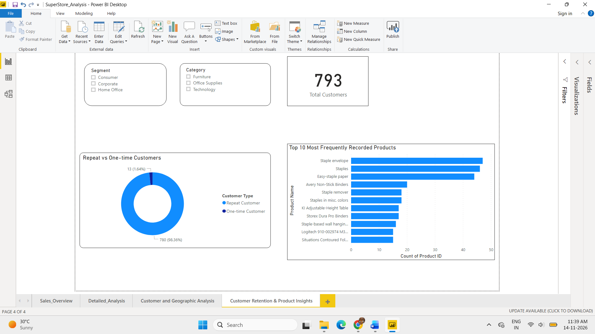

# Retail Sales Analysis | Excel, MySQL, Python & Power BI

## Project Overview

This project analyses retail sales data to identify business trends, evaluate product and regional performance, understand customer purchasing behaviour, and generate actionable business insights.

The project uses **Microsoft Excel, MySQL, Python and Power BI** for data preparation, analysis, forecasting and interactive visualisation.

## Dataset Information

- **Dataset:** Sales Forecasting – Superstore
- **Source:** [Kaggle – Sales Forecasting Dataset](https://www.kaggle.com/datasets/rohitsahoo/sales-forecasting)
- **CSV file:** `superstore.csv`
- **Records:** 9,800
- **Columns:** 18
- **Period:** 2015–2018

## Tools & Technologies

- **Microsoft Excel:** Data inspection, PivotTables, formulas and dashboard creation
- **MySQL:** Data storage, data quality checks and SQL analysis
- **Python:** Data analysis, RFM analysis, customer segmentation and sales forecasting
- **Google Colab:** Python development environment
- **Microsoft Power BI:** Interactive dashboards and visualisation
- **DAX:** Measures and customer classification

## Project Workflow

1. Dataset inspection and preparation.
2. Excel data analysis using PivotTables and formulas.
3. Database and table creation in MySQL.
4. CSV data import and verification.
5. SQL-based business analysis.
6. Python analysis, RFM segmentation and sales forecasting.
7. Power BI dashboard development using DAX.
8. Business insights and recommendations.

## Excel Analysis

Created an Excel workbook containing:

- Cleaned dataset sheet.
- PivotTables for category-wise, region-wise and segment-wise sales.
- Excel formulas and KPI calculations.
- Dashboard with four key metrics: Total Sales, Total Orders, Total Customers and Total Records.
- Charts for category-wise, region-wise, segment-wise and monthly sales comparison.
- Interactive slicers for Region, Category and Segment.

**Excel workbook:** [Retail_Sales_Analysis_Excel.xlsx](Retail_Sales_Analysis_Excel.xlsx)

### Excel Dashboard Screenshots

.png)

.png)

.png)

.png)

## Key Performance Indicators

| Metric | Result |
|---|---:|
| Total Sales | $2,261,536.78 |
| Total Records | 9,800 |
| Unique Orders | 4,922 |
| Unique Customers | 793 |
| Repeat Customers | 780 |
| One-time Customers | 13 |

## SQL Analysis

SQL queries cover:

- Data exploration and quality checks.
- Category, sub-category and regional performance.
- Customer and product analysis.
- Monthly and yearly sales trends.
- Shipping analysis.
- State and city performance.
- Customer purchase frequency and retention.

**SQL query file:** [queries.sql](queries.sql)

## Python Analysis

Python analysis performed in Google Colab includes:

- Missing-value and duplicate checks.
- Date-based sales analysis.
- Monthly and yearly sales trends.
- RFM (Recency, Frequency, Monetary) analysis.
- Customer segmentation.
- Sales forecasting for 2019 and 2020.

**Forecasted sales:**

| Year | Forecasted Sales |
|---|---:|
| 2019 | $782,220.19 |
| 2020 | $868,954.59 |

**Python notebook:** [Retail_Sales_Analysis_Python.ipynb](Retail_Sales_Analysis_Python.ipynb)

## Power BI Dashboards

Four dashboard pages:

1. Sales Overview
2. Detailed Analysis
3. Customer and Geographic Analysis
4. Customer Retention and Product Insights

**Power BI file:** [SuperStore_Analysis.pbix](SuperStore_Analysis.pbix)

### Power BI Dashboard Screenshots

## Key Business Insights

1. Technology generated $827,455.87, representing 36.6% of total sales.
2. West region contributed $710,219.68, representing 31.4%.
3. Consumer segment generated $1,148,060.53, representing 50.8%.
4. Phones was the top sub-category with $327,782.45 in sales.
5. California recorded the highest state sales at $446,306.46.
6. Repeat customers accounted for 780 of 793 customers.
7. November 2018 recorded the highest monthly sales at $117,938.16.
8. Annual sales increased by approximately 20.3% in 2018.

## Data Limitations

- The dataset does not contain Quantity, Profit or Discount columns.
- Sales figures should not be interpreted as profit.
- Product record frequency does not represent units sold.
- Shipping analysis measures order-to-ship time, not delivery time.

## Project Files

| File / Folder | Description |
|---|---|
| `queries.sql` | SQL analysis queries |
| `Retail_Sales_Analysis_Excel.xlsx` | Excel workbook and dashboard |
| `Retail_Sales_Analysis_Python.ipynb` | Python analysis notebook |
| `SuperStore_Analysis.pbix` | Power BI dashboard |
| `Documentation/` | Project documentation |
| `screenshots/` | Dashboard screenshots |

**Documentation includes:** Excel, SQL, Python and Power BI documentation, along with the final project report.

## Project Outcome

Developed an end-to-end retail sales analysis project using Excel, MySQL, Python and Power BI to explore 9,800 sales records, analyse customer behaviour, perform RFM segmentation, forecast sales and present business insights through interactive dashboards.
